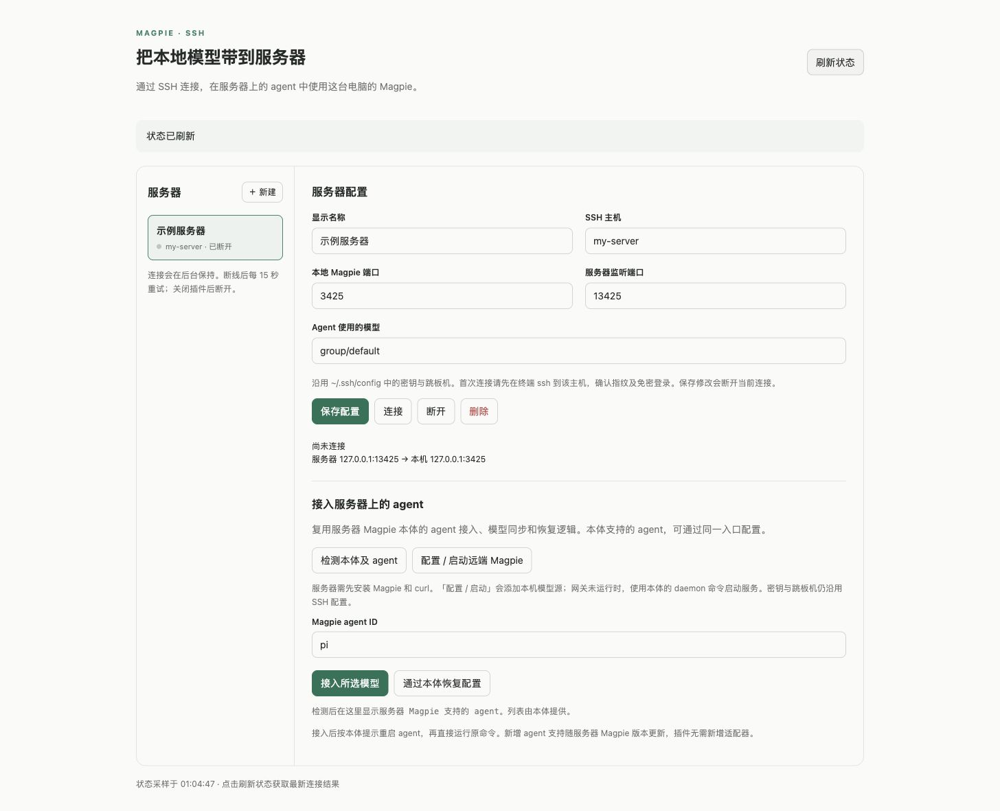

# Magpie SSH Remote

A local [Magpie](https://usemagpie.ai/) plugin that makes your desktop's models available to coding agents on an SSH server.

[中文说明](#中文说明) · [License](LICENSE)



## What it does

The plugin manages SSH connectivity and **reuses Magpie's native agent adapters on the server**. It does not implement one configuration writer per agent.

```text
Remote agent (pi / omp / dsh / Codex / any CLI-configurable Magpie agent)
    → server Magpie (native agent adapter)
    → Remote magpie provider
    → server 127.0.0.1:13425
    → SSH reverse tunnel
    → desktop Magpie 127.0.0.1:3425 → your providers
```

- Save multiple SSH servers, with your existing keys, aliases and ProxyJump.
- Verify the tunnel from the server and retry lost connections every 15 seconds.
- Inspect the server's supported agents using `magpie agents`.
- Add the desktop gateway as a Remote magpie provider on the server.
- Configure **any agent exposing a native `model` field** using the same generic CLI call; restore with Magpie's own `default` operation.
- Support new agents by updating server Magpie, without adding plugin adapters.

## Requirements

- macOS or Linux desktop with Magpie, Python 3.9+ and OpenSSH. Windows is unsupported.
- Magpie and curl installed on the server, plus any agents you want to configure.
- Noninteractive SSH authentication and reverse TCP forwarding enabled.
- Server Magpie's gateway must stay running. Setup uses its native `daemon install` / `daemon start` commands if no gateway is running; if the server lacks a working user service manager, run `magpie serve` yourself before setup.

The local plugin was verified with Magpie 0.1.1600 on macOS. Tests run on macOS and Linux. Actual agent availability and behavior depend on the server's installed Magpie version and native adapters.

## Install

```sh
magpie plugin add github:cliecy/magpie-ssh-remote
```

Or install a local checkout:

```sh
git clone https://github.com/cliecy/magpie-ssh-remote.git
magpie plugin add "$(pwd)/magpie-ssh-remote"
```

On macOS, if `magpie` is not on PATH, use `/Applications/magpie.app/Contents/MacOS/magpie`. Open **Plugins → SSH Remote**. Install either the GitHub package or local checkout, rather than both.

## Use

1. SSH to the server once in a terminal to verify its fingerprint and key authentication. Install Magpie there using the [official instructions](https://usemagpie.ai/docs/start).
2. Add the SSH alias / `user@host` in SSH Remote, choose the desktop model and save.
3. **Connect**, then **Refresh status** to confirm connectivity.
4. **Inspect Magpie and agents** to read the supported-agent report from the server.
5. **Configure / start remote Magpie** to register the desktop provider and start the native gateway if necessary.
6. Enter a native agent ID such as `omp`, `pi`, `dsh`, `codex`, `claude` or another supported ID, then **Connect selected model**.
7. Follow Magpie's restart instructions. Launch the agent with its ordinary command.

The same generic operation invokes:

```sh
magpie <agent-id> ssh-desktop-<profile-id>/<selected-desktop-model>
```

The adapter, configuration format, backup and restoration behavior all belong to **server Magpie**. To restore, select the agent and use **Restore through Magpie**, which delegates to `magpie <agent-id> default`. Agents requiring interactive GUI import or without a CLI `model` field must be configured through the server Magpie UI instead.

Changing the profile model does not automatically rewrite previously configured agents; click Connect selected model again for each agent you want to change. The suggestions list is only a convenience; it is not an allowlist.

## Lifecycle and migration

- Disconnect stops the tunnel and its retries. Saving edits disconnects it.
- Disabling/removing the plugin stops its helper and tunnels. Enabled profiles reconnect when it starts again.
- The helper exits after the desktop gateway is unavailable for over 30 seconds.
- State shown in the UI is a snapshot; use Refresh status for current information.
- Disconnecting a tunnel does not remove the server provider, restore agents or stop server Magpie's service. Restore agents explicitly while the server is reachable.
- No upstream provider credentials are copied. Requests still require this desktop to stay online.
- Version 0.1's `codex-magpie` / `claude-magpie` launchers are legacy. The 0.2 UI uses native Magpie configuration and ordinary agent commands. Existing launchers are not deleted automatically; the backend retains their install/remove protocol for older open pages.
- The default desktop loopback gateway accepts the client marker used by the Remote magpie provider. Setups requiring an explicit gateway key need additional key-configuration support.

## Security and local data

SSH runs with `BatchMode=yes` and `StrictHostKeyChecking=yes`. The helper does not accept unknown host keys or ask for passwords. Remote commands and model values are shell-quoted.

The requested server listener is `127.0.0.1`; keep the server's `GatewayPorts` set to `no` or `clientspecified` so SSH honors that binding. Other users on a shared server may still reach its loopback listener. Forward this gateway only to servers and accounts you trust: callers there can consume the models and quota available through your desktop gateway.

The plugin does not copy upstream provider credentials or subscription logins to the server. It does use your normal OpenSSH authentication. Profile state and diagnostic logs stay in:

```text
${XDG_CONFIG_HOME:-~/.config}/magpie/ssh-remote/
```

The plugin page uses Magpie's sandbox and its own options as a request/response mailbox. A bundled Python helper handles SSH and returns results through `magpie plugin options`. Installing it permits that helper to run with your local user rights.

Override executable discovery if needed:

```sh
export MAGPIE_SSH_PYTHON=/path/to/python3
export MAGPIE_SSH_BIN=/path/to/magpie
```

These variables must be visible to the process that starts Magpie. Server configurations and logs are runtime data, not part of this repository.

## Remove

Use **Restore through Magpie** for agents you want to disconnect first. Then remove the plugin:

```sh
magpie plugin rm magpie-ssh-remote
```

For a local checkout, use its absolute install path instead of the package name. Saved server profiles remain in the runtime folder so reinstalling can restore them; removing the plugin does not erase those files.

## Development

No package build or npm dependencies are required. The frontend is plain HTML/CSS/JavaScript, the entrypoint runs in Magpie's Bun plugin host, and the helper uses Python's standard library.

```sh
python3 -m unittest discover -s tests -p 'test_*.py' -v
node --test tests/*.test.mjs
node --check index.mjs
node --check page/app.js
```

Tests cover generic native Magpie setup, idempotent provider updates, agent help validation, configuration and restoration (including a future agent ID), reconnect handling, gateway port selection, corrupt state recovery, response republishing, stale UI requests, GitHub install resolution and legacy launcher compatibility. CI runs them on macOS and Linux.

The original frontend flow was validated with Magpie's official page bridge in a browser sandbox. The native adapter controls are additionally checked with a mock backend; no live server is changed by that UI check. A Magpie test instance can still discover real agents even with a separate configuration directory; do not treat `XDG_CONFIG_HOME` alone as complete agent isolation.

See the [Magpie plugin documentation](https://usemagpie.ai/docs/plugins) for the page and host APIs.

## 中文说明

SSH 远端接入通过服务器上的 Magpie 本体配置 agent，复用原生适配器，无需为 omp、pi、dsh 等各写一套配置逻辑。本体新增 agent 支持后，升级服务器 Magpie 即可。

使用步骤：服务器先安装 Magpie → 建立隧道 → 检测本体及 agent → 配置 / 启动远端 Magpie → 输入任意本体支持的 agent ID → 接入所选模型。接入后按本体提示重启，再直接运行原 agent 命令。

agent ID 输入框支持任意合法 ID，列出的建议项不是限制。支持范围是服务器 Magpie 原生 CLI 提供 `model` 字段的 agent；需要 GUI 导入的 agent 请通过本体界面操作。「通过本体恢复配置」调用原生 `default` 恢复机制。

断开隧道不会自动恢复 agent、移除服务器 provider 或停止本体服务。模型仍由本机 Magpie 提供，Mac 需持续联网。共享服务器的其他本机用户可能访问回环端口，请仅连接可信服务器。

0.1 版的独立启动命令是旧版兼容方式，0.2 版界面已改为本体原生接入。

## License

[MIT](LICENSE). This is an independent community plugin, not an official Magpie component.
